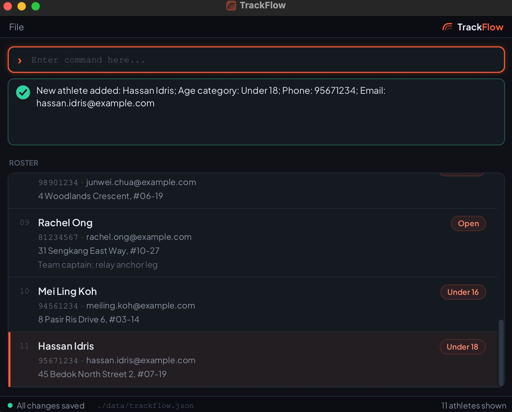

# TrackFlow User Guide

TrackFlow v1.5 is a **desktop application for managing a track-and-field athlete roster**. It is optimized for coaches who
prefer typing commands through a Command Line Interface (CLI), while retaining the benefits of a Graphical User
Interface (GUI).

<!-- * Table of Contents -->
<page-nav-print />

--------------------------------------------------------------------------------------------------------------------

## Quick start

1. Install **Azul Zulu JDK 25**. On macOS, use the **JDK FX** distribution, which includes JavaFX,
   and select the package matching your processor (Apple Silicon or Intel). See the
   [setup guide](SettingUp.md#runtime-and-build-requirements) for runtime requirements and packaging limitations.

1. Download the latest `.jar` file from
   [the TrackFlow releases page](https://github.com/AY2627S1-CS2103T-T17-2/tp/releases).

1. Copy the file to a writable folder you want to use as the _home folder_ for TrackFlow. Its data and settings
   will be stored beside the JAR. Use a separate copy in an empty folder when experimenting with test data.

1. Open a terminal, `cd` to the folder containing the JAR file, and run `java -jar TrackFlow.jar`. 
   On first launch, the GUI opens with sample athletes. On later launches, it opens your saved roster instead.
   This screenshot shows the running application after `list`: 
   

1. Type a command in the command box and press Enter to execute it. For example, type **`help`** and press Enter to open the help window. 
   Some example commands you can try:

   * `list` : Lists all athletes.

   * `add n/John Doe a/Open p/98765432 e/johnd@example.com addr/123 Main Street` : Adds an athlete named `John Doe` with age category `Open`.

   * `filter a/Under 14`: Shows athletes in that age category. Use `list` to show everyone again.

   * `sort name`: Sorts the displayed athletes by name in ascending order.

   * `find n/John`: Shows athletes whose names contain `John`. Run `list` to show everyone again.

   * `exit` : Exits the app.

1. Refer to the [Features](#features) section below for details of each command.

--------------------------------------------------------------------------------------------------------------------

## Features

<box type="info" seamless>

**Notes about the command format:** 

* Words in `UPPER_CASE` are the parameters to be supplied by the user. 
  For example, in `add n/NAME`, replace `NAME` with a value such as `John Doe`.

* Items in square brackets are optional. 
  For example, `edit INDEX [n/NAME]` can be used as `edit 1 n/John Doe` or as part of an edit with other fields.

* Items followed by `...` can appear zero or more times. 
  For example, `find KEYWORD [MORE_KEYWORDS]...` can include `Avery` or `Avery Tan`.

* Field prefixes can be in any order. For `find`, put unprefixed keywords before field prefixes. 
  For example, if the command specifies `n/NAME p/PHONE`, `p/PHONE n/NAME` is also acceptable.

* Command words and parameter prefixes are case-insensitive. For example, `LIST`, `List`, and `list` invoke the same
  command, while `n/Avery` and `N/Avery` supply the same name parameter.

* The `list`, `help`, `clear`, and `exit` commands do not accept parameters.

* Leading and trailing spaces around a command or parameter value are ignored. Pasted Unicode spaces, including
  non-breaking and em spaces, are accepted between the command word and parameters, before prefixes, and between
  `sort` arguments or broad `find` keywords. Spaces inside field values are preserved and follow that field's rules.
  Invisible zero-width characters are not separators.

* Enter one command per submission, using spaces to separate its word and parameters. The command box is a
  single-line field: pasted tabs and line breaks can be removed, joining adjacent text. Replace them with spaces
  before pasting a command. TrackFlow does not execute batches of commands.

* Indexes use digits `0`–`9` and must identify a displayed athlete. Leading zeroes are accepted (`0001` means `1`).
  Zero, signs, decimals, and extra words are rejected; very large numbers report an invalid displayed index.

* If you are using a PDF version of this document, be careful when copying and pasting commands that span multiple lines as space characters surrounding line-breaks may be omitted when copied over to the application.
</box>

### Working with the displayed list

`find` and `filter` select athletes from the full roster. Each replaces the previous selection; they do not narrow
the results of the preceding command. `sort` orders the selected athletes, and `list` shows everyone in saved roster
order. Sorting and filtering are reset when TrackFlow restarts.

While a `find` or `filter` is hiding some athletes, the status bar shows the count as `X of Y athletes` (for
example, `2 of 9 athletes`), so you can tell you are viewing a subset even after a later command such as `sort`
changes the feedback message. It shows `Y athletes` when the whole roster is displayed.

For `edit`, `remark`, `tag`, `untag`, and `delete`, always use the index currently shown beside the athlete.
Indexes can change after another command. A successful add, edit, remark, tag, or untag shows the full roster again;
deleting an athlete keeps the current filter. Check the displayed names before your next indexed command.

When the list area is empty, it explains why: if the roster has no athletes (for example, on first launch or after
`clear`), it shows how to add one; if a `find` or `filter` matched nothing, it says so and reminds you to run `list`.

### Addresses and remarks containing slashes

Type ordinary addresses and notes normally. If the text looks like a command parameter, such as `A/B` or `r/relay`,
double its slash to enter it literally:

* `edit 1 addr/Block A//B` stores `Block A/B`.
* `remark 1 r/Practise r//relay on Mon/Tue` stores `Practise r/relay on Mon/Tue`.
* `find addr/Block A//B` searches that address.

This applies only to a token shaped like a single-letter parameter or `addr/`. URLs such as
`https://example.com/a//b`, network paths such as `//server/share`, backslashes, and quotation marks have no escape
behaviour. Exactly one extra slash is removed, once: enter `A///B` to store `A//B`.
Do not use quotes to escape parameters: they are kept as part of the value, and a parameter after a space
inside quoted text is still recognised. Use `//` for literal parameter-like text instead.

If a value begins with a slash, put a space after the real parameter: `edit 1 addr/ /home/coach` stores
`/home/coach`. An escaped token never replaces a required parameter, and repeated real parameters still cause an error.

### Command autocomplete

TrackFlow provides an autocomplete feature to speed up typing and ensure correct command formats.

* As you type a command word in the command box, a dropdown menu will appear with suggested commands, including mandatory index parameters and prefixes (e.g., `edit INDEX n/ a/ p/ e/ addr/`, `delete INDEX`, `remark INDEX r/`). For `sort`, the suggestion lists the supported fields and orders: `sort name|age|phone|email|address [asc|desc]`. Suggestions are matched case-insensitively.
* Use the **Up** and **Down** arrow keys to navigate the list of suggestions.
* Press **Tab**, or **Click** on a suggestion, to select it. This will insert the command word (followed by a space) into the command box and close the suggestions dropdown.
* Pressing **Enter** does **not** select or apply a suggestion; it closes the suggestions dropdown and executes the command currently typed in the command box.
* After you enter the command word (or select it with **Tab**), press **Tab** again to insert the next missing prefix.
  For `edit`, `remark`, `tag`, and `untag`, type the athlete index first; autocomplete does not insert it for you.
  After typing a parameter value, press **Tab** to insert the next missing prefix.
* Prefixes already entered in the command box (even in uppercase or in a different order) are recognized and skipped automatically.
* Press **Escape** to dismiss suggestions. **Shift+Tab** moves focus backward. When no suggestion or prefix is
  available, **Tab** moves focus to the next control, allowing keyboard access to feedback and the roster.

### Window size and scrolling

TrackFlow restores its normal window size and position when reopened. If the saved window is too large or its
monitor is disconnected, TrackFlow fits the window into a connected screen's usable area. The normal minimum is
450 by 400 pixels, reduced further if the screen has less usable space. Maximizing or minimizing does not replace
the last normal window bounds. Adding or editing athletes does not automatically enlarge the window.

Resize the window as needed. Athlete details wrap, the roster scrolls, and long command feedback can be scrolled
within the result area. The command box and status footer remain separate from the scrolling roster.

### Command feedback and errors

After a successful command, TrackFlow displays a confirmation message and clears the command box. If parsing,
validation, or command execution fails, TrackFlow displays an error and leaves the entered command in the command box
so that it can be corrected.

* Submitting an empty or whitespace-only command displays
  `No command entered. Type a command and try again.`
* An unrecognized command displays `Unknown command: COMMAND.`, where `COMMAND` is the command word entered. For
  example, `enrol n/Avery` displays `Unknown command: enrol.`
* Validation errors explain the accepted format or constraint. The roster is not changed when parsing or validation
  fails.
* Parameters a command does not support, such as `t/` in `add`, are rejected with an error.
  To enter prefix-like text as part of an address or remark, see
  [Addresses and remarks containing slashes](#addresses-and-remarks-containing-slashes).

### Viewing help: `help`

Opens a resizable, scrollable help window listing every supported command, its purpose,
parameters, and examples. It opens on the main window's screen and fits the available space. Running `help`
again restores it if minimized. Closing and reopening help retains its position during the current session.

Format: `help`

### Adding an athlete: `add`

Adds an athlete with a name, age category, phone number, email address, and address.

Format: `add n/NAME a/AGE_CATEGORY p/PHONE e/EMAIL addr/ADDRESS`

* All five fields are required.
* Fields may appear in any order. Each parameter may appear only once.
* Age category must be `Under 14`, `Under 16`, `Under 18`, `Under 20`, or `Open`. Category input ignores case and normalizes repeated spaces.
* Names are words of ASCII letters (`A`–`Z`, `a`–`z`) and digits, separated by ordinary spaces. A single hyphen or
  apostrophe may join two words (for example, `Mary-Jane` or `O'Brien`), but a name cannot start or end with one,
  repeat one (`Mary--Jane`), or put spaces around one (`Mary - Jane`). Accented letters and other writing systems are
  not currently supported.
* Phone numbers must contain at least three significant digits. They may also include spaces, `+`, `-`, `(`, and
  `)`. A bracketed country code such as `(+65)` is part of the number, but any other bracketed text is treated as a
  note and ignored, whether it is letters like `(HP)` or digits like `(5)` (for example, `+65 9123 4567`,
  `(+65) 9123 4567`, or `9123 4567 (HP)`).
* Emails must have the form `local-part@domain`. The local part consists of alphanumeric groups separated by `+`, `_`, `.`, or `-`. Domain labels consist of alphanumeric groups separated by hyphens; the final label must have at least two characters. Spaces are not allowed.
* Add and edit reject a duplicate when the normalized name matches and either the phone or email matches, regardless of age category. Phone comparisons ignore bracketed notes (including digits), but count a bracketed country code such as `(+65)`. Name comparisons ignore case and repeated spaces; email comparisons ignore case. A different name sharing a phone or email is allowed with a possible-duplicate warning naming the matching athletes. Both checks search the full roster.
* Use `addr/ADDRESS` to supply the required nonblank address. Addresses can contain any characters except line
  breaks, including pasted line or paragraph separators.
* Add does not accept events or remarks. `edit` updates athlete details and addresses, `tag` and `untag` update track events, and `remark` updates remarks. **`a/` means age category for `add`, `edit`, and `filter`.** Use `addr/` with `edit` to update addresses.
* Athletes are saved automatically. Older saved entries without an age category load as `Open`, retaining their
  existing address, events, and remarks. Saved rosters are checked using the same duplicate rule on loading.

Examples:

* `add n/Kaylee Teo a/Under 14 p/61234567 e/kaylee.teo@example.com addr/123 Main Street`
* `add e/jordan.lee@example.com p/62345678 a/open n/Jordan Lee addr/123 Main Street`

Successful output:

`New athlete added: Kaylee Teo; Age category: Under 14; Phone: 61234567; Email: kaylee.teo@example.com`

A duplicate produces `This athlete already exists in the roster: Avery Tan.` Failed validation leaves the command text available for correction.

Command words and parameter prefixes are case-insensitive. Use `sort` to change the displayed order. TrackFlow reports
a roster-changing command as successful only after saving it. If saving fails, the roster and displayed list remain
unchanged so that the application never presents an unsaved change as permanent.

### Listing all athletes: `list`

Shows the complete athlete roster.

Format: `list`

The command restores the complete roster in saved roster order after a `find`, `filter`, or `sort` command.
It clears the active filter and sort without changing saved data. It does not accept parameters.

* An empty roster displays `The athlete roster is empty.`
* A roster with one athlete displays `Displaying 1 athlete.`
* A larger roster displays `Displaying COUNT athletes.`, where `COUNT` is the number of athletes displayed.
* Supplying a parameter, such as `list 1`, displays
  `The list command does not accept parameters. Format: list`.

Examples:

* `list`
* `LiSt` (command words are case-insensitive)

### Filtering athletes by age category: `filter`

Use `filter` to show athletes whose recorded age category matches the category you specify.

Format: `filter a/AGE_CATEGORY`

* Supply exactly one `a/` parameter. Accepted categories are `Under 14`, `Under 16`, `Under 18`, `Under 20`, and `Open`.
* Category values ignore case and repeated spaces: `filter a/under   14` is equivalent to `filter A/Under 14`.
* Matching uses the recorded category, not an exact age or eligibility calculation. `Under 16` does not include athletes recorded as `Under 14`.
* Each `filter` searches the entire roster and replaces any previous `find` or `filter`. Likewise, `find` replaces the age filter. Matching athletes retain the current displayed ordering, including any active sort, and receive indexes starting from 1.
* Filtering does not change or delete athlete records. Use `list` to show everyone again, including after no matches. TrackFlow does not save the filter between application sessions.
* Missing `a/` shows command usage. An empty or unsupported category (for example, `filter a/Under 15`) shows `Age category must be Under 14, Under 16, Under 18, Under 20, or Open.` Repeated `a/` parameters and extra arguments are rejected. An invalid filter leaves the previous display and roster unchanged.

Feedback examples:

* Two matches: `Displaying 2 athletes in age category Under 14.`
* One match: `Displaying 1 athlete in age category Under 14.`
* No matches (including an empty roster): `No athletes found in age category Under 14 (0 matches).` The displayed list is empty; this is a successful search, not an error.

To filter the roster and return to the complete list, follow these steps:

1. Run `filter a/Under 14`. TrackFlow displays only athletes recorded as `Under 14`.
1. Review the displayed athletes. If you use an indexed command, use the indexes in this filtered list. An index outside the displayed list is invalid even if it exists in the full roster.
1. Run `list` to display the complete roster again.

### Editing an athlete: `edit`

Edits an existing athlete in the roster.

Format: `edit INDEX [n/NAME] [a/AGE_CATEGORY] [p/PHONE] [e/EMAIL] [addr/ADDRESS]`

* Edits the athlete at the specified `INDEX`. The index refers to the index number shown in the displayed athlete list. The index **must be a positive integer** 1, 2, 3, ...
* At least one of the optional fields must be provided.
* Existing values will be updated to the input values.
* At least one field must be different from the athlete's current details.
* Omitted fields retain their current values. Track events and remarks are preserved.
* `a/` means age category. Supported categories are `Under 14`, `Under 16`, `Under 18`, `Under 20`, and `Open`;
  case and repeated ordinary spaces are normalized. Addresses use the separate `addr/` prefix.
* Use `addr/ADDRESS` to edit the address. An empty or whitespace-only address is rejected.
* Repeated field prefixes, empty or invalid values, and `t/` or `r/` parameters are rejected. Use `tag`/`untag` for events and `remark` for remarks.
* Edits that create a duplicate athlete are rejected (producing `This athlete already exists in the roster: Avery Tan.`) using the same normalized name and contact comparison as `add`.
* A successful edit displays the full roster again; failed edits leave the roster and displayed list unchanged.

Examples:

*  `edit 1 addr/123 Main Street` Updates the 1st athlete's address.
*  `edit 1 p/91234567 e/johndoe@example.com` Edits the phone number and email address of the 1st athlete to be `91234567` and `johndoe@example.com` respectively.
*  `edit 2 n/Betsy Crower a/Under 16` Edits the name and age category of the 2nd athlete, retaining their other details.

### Adding or removing an athlete remark: `remark`

Replaces the remark of an athlete in the currently displayed list. Use remarks for general notes such as injuries,
personal bests or availability. To record which track events an athlete competes in, use [`tag`](#tagging-athletes-with-track-events-tag-untag) instead.

Format: `remark INDEX r/[REMARK]`

* `INDEX` refers to the index number shown in the displayed athlete list and must be a positive integer.
* Exactly one `r/` prefix is required. The prefix is case-insensitive.
* A new remark replaces the existing remark; remarks are not appended.
* Use an empty remark, such as `remark 1 r/`, to remove the athlete's existing remark.
  If the athlete already has no remark, TrackFlow reports `Athlete has no remark to remove` followed by their
  details, and leaves the roster and current view unchanged.
* Remarks form part of the saved athlete record and remain after restarting TrackFlow.
* Updating a remark preserves the athlete's age category and other details.
* A successful remark update displays the full roster again and retains the current sort order.

Examples:

* `remark 1 r/100m personal best: 12.34s`
* `remark 2 r/` removes the 2nd athlete's remark.

### Tagging athletes with track events: `tag`, `untag`

Records which track events each athlete competes in. Events are shown as labels on the athlete's card. For other
notes, such as injuries or personal bests, use [`remark`](#adding-or-removing-an-athlete-remark-remark).

Format: `tag INDEX t/EVENT [t/EVENT]...` 
Format: `untag INDEX t/EVENT [t/EVENT]...`

* `tag` adds the given events to the athlete at `INDEX`. The athlete's existing events are kept.
* `untag` removes the given events from the athlete at `INDEX`.
* `INDEX` refers to the index number shown in the displayed athlete list and must be a positive integer.
* At least one `t/EVENT` is required. Give `t/` once per event to add or remove several events at once.
* An event is made of words of letters or digits, separated by a single space or a single hyphen, and can be up to
  30 characters long, e.g. `100m`, `4x100m`, `Long Jump`, `110m-Hurdles`. Extra spaces between words are reduced to
  one, but a hyphen cannot have spaces around it or be repeated: use `Long-Jump` or `Long Jump`, not `Long - Jump`
  or `Long--Jump`.
  Letters include accented and non-English letters, e.g. `Saut-Élan`.
* Events ignore case: `100m` and `100M` are the same event. An event keeps the capitalisation it was first added with.
* Older rosters may contain alphanumeric tags longer than 30 characters. TrackFlow preserves these exactly when
  loading and saving. They remain searchable and can be removed with `untag INDEX t/EXACT_NAME`, ignoring case.
  The 30-character limit still applies when adding a new event with `tag`.
* If the athlete already has some of the events given to `tag`, only the new events are added and the message lists
  the events that were skipped, as stored on the athlete. If the athlete already has all of them, an error is shown.
* If any event given to `untag` is not one of the athlete's events, an error is shown and **no** events are removed.
  This guards against removing the wrong events because of a typo.
* A successful `tag` or `untag` displays the full roster again.

Examples (run in order on the sample data):

* `tag 2 t/200m t/4x100m` adds `200m` and `4x100m` to the 2nd athlete. 
  Output: `Added event(s) 200m, 4x100m to Daniel Lim.`
* `tag 2 t/400M t/Relay` adds only `Relay`, because the athlete already has `400m`. 
  Output: `Added event(s) Relay to Daniel Lim. Already had: 400m.`
* `tag 3 t/Long Jump` adds `Long Jump` to the 3rd athlete. 
  Output: `Added event(s) Long Jump to Priya Nair.`
* `untag 1 t/200m` removes `200m` from the 1st athlete. 
  Output: `Removed event(s) 200m from Avery Tan.`

### Finding athletes across all or selected fields: `find`

Finds athletes using broad keywords, field-specific values, or both.

Format: `find [KEYWORD]... [n/NAME] [a/AGE_CATEGORY] [p/PHONE] [e/EMAIL] [addr/ADDRESS] [r/REMARK] [t/EVENT]`

* Searchable fields are name, age category, phone, email, address, remark, and track events.
* Matching is case-insensitive and accepts partial values.
* Before any field prefix, each space-separated value is a keyword. An athlete is returned when at least one keyword occurs in at least one
  searchable field (an `OR` search). This broad form remains useful when the field is unknown.
* Prefix a value to restrict it to one field: `n/` name, `a/` age category, `p/` phone, `e/` email, `addr/` address,
  `r/` remark, or `t/` event. For example, `find n/und` searches names without matching every `Under` age category.
* When several field prefixes are given, an athlete must match **every** one (an `AND` search). For example,
  `find n/avery a/Under 16` returns only athletes named like `avery` **and** in the `Under 16` category.
* Broad and field-specific criteria can be combined. An athlete is returned when at least one broad keyword matches
  **or** every field-specific value matches. Each field prefix may appear at most once and cannot have an empty value.
* Broad keyword order does not matter: `find Avery Tan` and `find Tan Avery` return the same results. A prefixed value is matched as one phrase, so `find n/Avery Tan` matches that name but `find n/Tan Avery` does not. Put broad keywords before any field prefixes. Each athlete appears at most once.
* Name searches ignore repeated ordinary spaces: `find n/Avery   Tan` and `find n/Avery Tan` match both
  `Avery Tan` and `Avery   Tan`. Stored names are unchanged. Other field searches retain literal internal spacing.
* Each `find` searches the entire roster and replaces any previous `find` or `filter`. Matching athletes retain the
  current displayed ordering, including any active sort, and receive indexes starting from 1. Use `list` to restore the complete roster.
* An empty or whitespace-only search is rejected and displays the accepted command format.

Feedback:

* No matches: `No matching athletes found.`
* One match: `Displaying 1 matching athlete.`
* Multiple matches: `Displaying COUNT matching athletes.`

Examples:

* `find ave` searches partial names and can return `Avery Tan`.
* `find under` searches age categories such as `Under 14` and `Under 16`.
* `find n/und` searches only names, so an athlete named `Underwood` can be found without matching age categories.
* `find a/under 16` searches only age categories.
* `find 9123` searches partial phone numbers.
* `find p/9123` searches only phone numbers.
* `find tan@exam` searches partial email addresses.
* `find r/injured` searches only remarks.
* `find t/hurdles` searches only events, returning athletes with an event such as `Hurdles` or `110m-Hurdles`.
* `find avery 9123 under` returns athletes matching any of the three keywords.
* `find n/rachel r/relay` returns only athletes whose name contains `rachel` **and** whose remark contains `relay`.

### Sorting the displayed athletes: `sort`

Sorts the currently displayed athlete list by a selected field.

Format: `sort FIELD [ORDER]`

Available fields:

* `name` sorts names alphabetically without considering letter case or repeated ordinary spaces. For example,
  `Lee Ann` sorts before `Lee  Bob` (two spaces). Displayed and saved name text is unchanged; names differing only
  in case or repeated spaces compare equally for sorting.
* `age` sorts competition categories in this order: `Under 14`, `Under 16`, `Under 18`, `Under 20`, `Open`.
* `phone` sorts phone numbers numerically by their significant digits. Formatting and bracketed notes such as
  `(HP)` or `(5)` are ignored, while a bracketed country code such as `(+65)` counts as part of the number.
  For example, `200 (5)` sorts before `300`, and `(+65) 200` sorts after both. Displayed and saved phone text is unchanged.
* `email` sorts email addresses alphabetically without considering letter case.
* `address` sorts addresses alphabetically without considering letter case. Empty addresses appear first in ascending
  order and last in descending order.

Available orders are `asc` or `ascending`, and `desc` or `descending`. If `ORDER` is omitted, ascending order is used.
Field and order names are case-insensitive.

Sorting changes only the displayed order; it does not rewrite the saved roster order. The selected ordering remains
active until `list` or a restart, including after `find`, `filter`, and roster-changing commands
such as `add`, `edit`, `remark`, and `delete`. New or edited athletes automatically move to the correct position in the
displayed list. A later `sort` command replaces the selected ordering. Indexed commands such as `edit`, `remark`, and
`delete` use the indexes shown in the sorted list.

Use `list` to show the full roster in saved order. This clears any active sort and filter without saving data.

Examples:

* `sort name` sorts names in ascending order.
* `sort name desc` sorts names in descending order.
* `sort age ascending` places `Under 14` before the older categories and `Open`.
* `sort age desc` reverses the category order.
* `sort phone` sorts by numeric phone value.

Successful output follows this format:
`Sorted the displayed athlete list by FIELD in ORDER order.`

Invalid sort commands leave the displayed list unchanged. Examples of errors include:

* `sort` or `sort name asc extra`: displays the accepted command format because a field is missing or there are too
  many arguments.
* `sort height`: displays `Unknown sort field: height. Available fields: name, age, phone, email, address.`
* `sort name upwards`: displays `Unknown sort order: upwards. Use asc, ascending, desc, or descending.`

### Deleting an athlete: `delete`

Deletes the specified athlete from the roster.

Format: `delete INDEX`

* Deletes the athlete at the specified `INDEX`.
* The index refers to the index number shown in the displayed athlete list.
* The index **must be a positive integer** 1, 2, 3, ...
* On success, the deleted athlete's details are shown, e.g. `Athlete deleted: Avery Tan; Age category: Under 18; Phone: 91234567; Email: avery@example.com`.

Examples:

* `list` followed by `delete 2` deletes the 2nd athlete in the roster.
* `find Avery` followed by `delete 1` deletes the 1st athlete in the results of the `find` command.

### Clearing all entries: `clear`

Deletes all athletes from the roster.

Format: `clear`

The command does not accept parameters.

**This action is permanent:** `clear` immediately saves an empty roster, with no confirmation or undo. Close the app
and back up `data/trackflow.json` in the JAR's home folder before clearing data you may need later. `delete` also saves
its deletion immediately.

### Exiting the program: `exit`

Exits the program.

Format: `exit`

The command does not accept parameters.

### Saving the data

TrackFlow automatically saves after every successful command that changes roster data: `add`, `edit`, `remark`,
`tag`, `untag`, `delete`, and `clear`. Commands that only change the displayed view or open a window do not rewrite
the data file.
TrackFlow writes the complete update to a temporary file before replacing the existing roster, so an interrupted write
does not leave a partially written roster when atomic replacement is supported by the filesystem. On other
filesystems, TrackFlow moves the completed temporary file into place without an atomicity guarantee.
If saving fails, the command reports an error and the in-memory roster, filter, and sort order remain unchanged.
Fix the file or folder permissions, then retry the command. `list`, `find`, `filter`, `sort`, `help`, and `exit` remain
available without saving the roster. You do not need to save manually.

### Editing the data file

TrackFlow saves roster data to `data/trackflow.json` inside the folder containing the JAR, even if you launch it
from another folder. If you launch through a symbolic link to the JAR, it uses the actual JAR's folder.
Preferences (`preferences.json`) and rotated logs (`trackflow.log.0`, etc.) use that same home folder. Roster backups
and temporary save files stay beside the roster. When running unpacked classes from an IDE, home is the process
working directory instead.

If no roster file exists there, TrackFlow starts with sample athletes and creates the file after the first
successful command that changes roster data. An intentionally saved empty roster remains empty on restart.

If an older version saved your roster in another launch folder, close TrackFlow and back up both locations before
copying that folder's `data/trackflow.json` into the JAR's `data` folder. Copy `preferences.json` too if you want to
retain your window settings. Keep a separate copy of any existing destination roster before replacing it.

Missing or unreadable preferences, null window settings, or invalid window dimensions cause TrackFlow to use and
attempt to save default settings. This recovery does not change athlete data.

Close TrackFlow and make a separate backup before editing this file manually.

<box type="warning" seamless>

**Caution:**
If the saved roster cannot be loaded, TrackFlow preserves the original file in
`data/trackflow.json.unreadable-<UUID>.bak`, logs the backup path, and starts with an empty roster.
Later roster changes leave the backup intact. If the backup cannot be created, TrackFlow stops startup to
protect the original file. Keep the preserved copy if you need to recover its records manually.
</box>

--------------------------------------------------------------------------------------------------------------------

## FAQ

**Q**: How do I transfer my data to another computer? 
**A**: Install TrackFlow on the other computer and overwrite the data file it creates with the data file from your
previous TrackFlow home folder. Close TrackFlow on both computers first and back up any destination roster before
replacing it. Put the JAR in the destination home folder so TrackFlow reads its `data/trackflow.json`.

--------------------------------------------------------------------------------------------------------------------

## Known issues

* **Runtime packaging:** the bundled JavaFX dependencies do not include an Apple Silicon classifier. Use the Zulu
  JDK 25 FX runtime on macOS and verify the packaged JAR on your machine. See the
  [setup guide](SettingUp.md#runtime-and-build-requirements) for runtime requirements.
* **One app instance per roster:** close the existing instance before opening the same JAR again. Two instances do
  not coordinate edits and a later save can overwrite changes from the other instance.

--------------------------------------------------------------------------------------------------------------------

## Command summary

Action     | Format, Examples
-----------|----------------------------------------------------------------------------------------------------------------------------------------------------------------------
**Add**    | `add n/NAME a/AGE_CATEGORY p/PHONE e/EMAIL addr/ADDRESS`   e.g., `add n/James Ho a/Under 18 p/22224444 e/jamesho@example.com addr/123 Main Street`
**Clear**  | `clear`
**Delete** | `delete INDEX`  e.g., `delete 3`
**Edit**   | `edit INDEX [n/NAME] [a/AGE_CATEGORY] [p/PHONE] [e/EMAIL] [addr/ADDRESS]`  e.g.,`edit 2 n/James Lee e/jameslee@example.com`
**Filter** | `filter a/AGE_CATEGORY`  e.g., `filter a/Under 14`
**Find**   | `find [KEYWORD]... [n/NAME] [a/AGE_CATEGORY] [p/PHONE] [e/EMAIL] [addr/ADDRESS] [r/REMARK] [t/EVENT]`  e.g., `find n/rachel r/relay`, `find t/100m`
**List**   | `list`
**Remark** | `remark INDEX r/[REMARK]`  e.g., `remark 1 r/100m personal best: 12.34s`
**Sort**   | `sort FIELD [ORDER]`  e.g., `sort age desc`
**Tag**    | `tag INDEX t/EVENT [t/EVENT]...`  e.g., `tag 1 t/100m t/Long Jump`
**Untag**  | `untag INDEX t/EVENT [t/EVENT]...`  e.g., `untag 1 t/100m`
**Help**   | `help`
**Exit**   | `exit`
